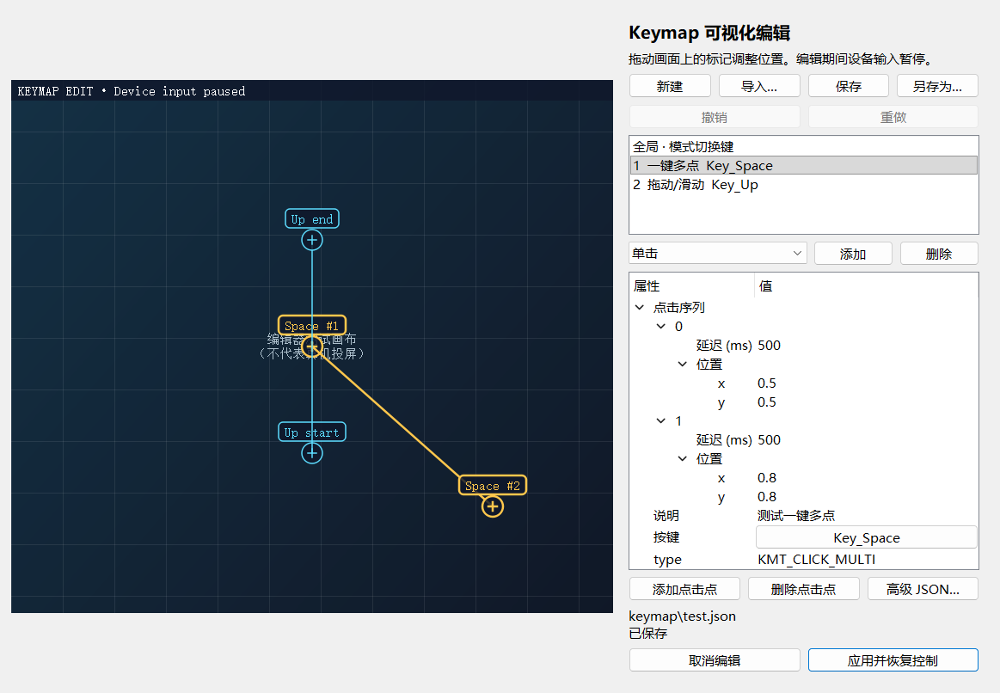

# Keymap 可视化编辑实现及验证记录

日期：2026-10-18。开发分支：`Beta/runtime-keymap-editor`。

上游基线：QtScrcpy `b018bec82cc32113cfd13e4ca7e0f198d71c69ef`（dev）；Core 基线 `9e388b8aa48e4e1c2cfdef408ef00c4c6b45c921`。Core 变更提交 `68ec909b5d2c943505008658bf8272ec856610a5`，已推送到用户的 Core Fork。主仓库通过子模块固定该提交。

## 已实现

- 投屏上的控件叠加层，基于实际视频区域的相对坐标进行拖动。
- 全部现有映射类型、切换键、鼠标视角和小眼睛；属性树与高级 JSON 编辑。
- 新增、删除、键鼠录制、撤销/重做、多点序列编辑、导入与原子保存/另存。
- 编辑时暂停输入、释放已有触点和 Android 按键、取消延迟动作、恢复鼠标光标；应用后立即恢复自定义映射。
- 群控主机进入编辑前释放从机上的已传播输入，编辑中的设备不接收新的群控输入。
- 区分取消的草稿与已经应用但未保存的配置，在断线和销毁窗口时自动保留恢复文件；使用 UUID 避免多设备文件名碰撞。

## 验证结果

| 检查 | 结果与范围 |
| --- | --- |
| 配置/界面 Qt Test | 12 个用例通过，包含初始化/清理；覆盖内置脚本、无损往返、无效导入、撤销/重做、坐标限制、拖拽、键鼠录制、文件失败、恢复策略，以及所有新建映射对真实 Core 解析器的兼容性 |
| Core 输入生命周期 Qt Test | 9 个用例通过，包含初始化/清理；覆盖触点、Android 按键和普通鼠标的释放，暂停时输入隔离、延迟动作取消、模式恢复和鼠标光标恢复 |
| Windows Release | Qt 5.15.2、MSVC 19.51、原生 Windows CMake/Ninja，构建通过，项目启用警告作为错误 |
| 编辑器渲染 | 使用真实 C++ 控件生成预览并目视检查，属性与按钮可见，无遮挡；画布是测试背景，并非真机投屏 |
| 独立审查 | Sol 子代理完成只读审查和复查，发现的三个重要问题均已修复；复查未发现剩余重要问题 |
| Portable 启动 | 复制到独立测试目录，PATH 仅保留 Windows 系统目录；应用启动成功，Qt/VC/FFmpeg DLL 均从测试包内加载，无开发 SDK 路径依赖 |
| 软件 OpenGL | 同一隔离目录成功创建 OpenGL 上下文，报告 `3.0 Mesa 12.0.0-rc2` |
| FFmpeg | 独立构建 4.4.2，运行时许可报告 LGPL-2.1-or-later；包内库成功解码并转换 10 帧 H.264 测试视频 |
| 包完整性 | 59 个包内文件的 SHA-256 核对通过，ZIP CRC 完整性检查通过；`SHA256.json` 不包含自身 |

## 尚未验证

检查时 `adb devices -l` 没有连接设备，因此尚未验证真实手机上的触摸效果、投屏横竖屏/全屏、实体断线和多设备群控。Linux/macOS 未在本次环境中编译测试。首版为供设备验证的 Windows x64 开发版本。

本机已有下载版 QtScrcpy 在运行，启动测试通过独立测试实例名隔离，没有结束用户的旧进程。使用新包时，请先退出旧版本，以免单实例机制把激活请求转发给旧窗口。

## 构建环境变更

系统 Python 新增 aqtinstall 及其依赖；Qt 5.15.2 SDK 安装到 `D:\Develope\Qt`。MSYS2 UCRT64 新增 make、nasm 和 diffutils，用于构建兼容的 FFmpeg DLL；其源码、构建目录与安装目录位于 `D:\Develope\FFmpeg\4.4.2-lgpl`。未修改全局 PATH。

上游自带的 FFmpeg DLL 启用了 nonfree，并报告不可再分发。本次 Portable 包使用独立构建的 LGPL DLL，源仓库的上游 vendor 文件保持原样。操作说明、许可、对应 FFmpeg 源码和构建配置随包提供。

